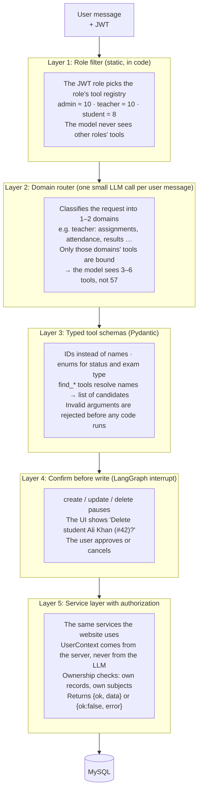
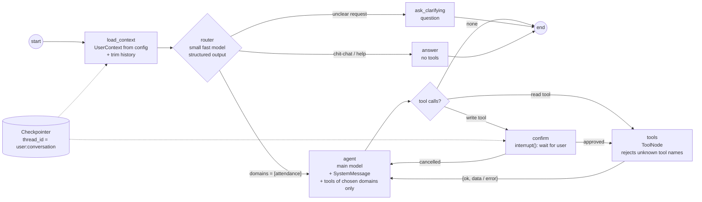
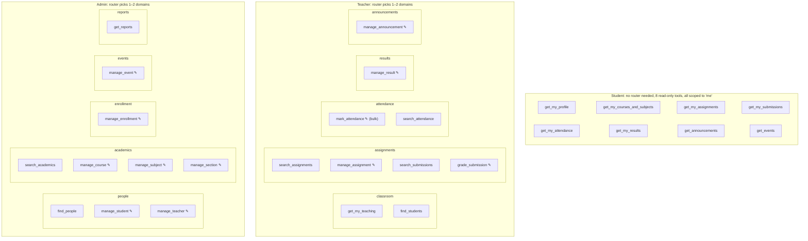
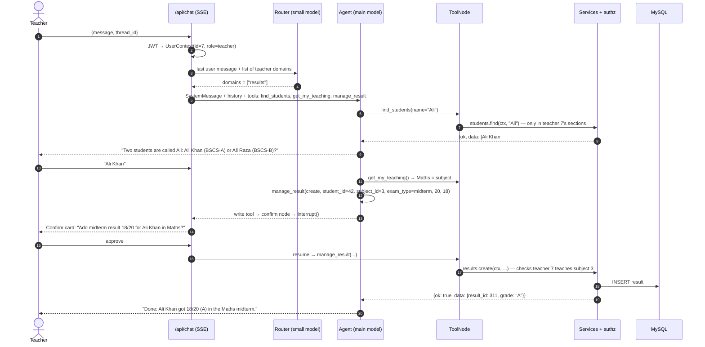

# LMS: Analysis and Fix Plan

**Date:** 2026-11-03
**Scope:** All of `backend/` (Flask, SQLAlchemy, LangGraph agent) and `frontend/` (React, TypeScript, Vite).
**Method:** Every source file was read. Tool-to-service call signatures were checked with an AST script. Each critical finding was then re-checked against the code.

---

## TL;DR

1. **Much of the agent is broken.** It does not just suffer from having too many tools:
   - The system prompt is sent as an *AI* message, and it is dropped after the first tool call and on every follow-up turn.
   - 6 tools are defined twice, and the second copy silently replaces the first.
   - The prompt tells the model to call 5 tools that don't exist.
   - `create_teacher` crashes on every call.
   - About 30 tools hand the model an unreadable Flask `Response` object instead of data.
   - For students, 3 of their 5 tools always fail.
   - For admins, 10 of their 57 tools always fail.
2. **Tool count.** The admin model gets **57 tool schemas on every LLM call**, which is about 8–10k tokens per call, repeated on every loop step. The "cache tool schemas" commit (`16c1e41`) saves a little CPU but **no tokens**, because the schemas are still sent with each request.
3. **The backend has critical security holes:**
   - Anyone can create an admin account without logging in.
   - Any logged-in user, including a student, can change marks on any submission or delete it.
   - File uploads can write to any path on the server and are served publicly with no login.
4. **Missing ownership checks.** No check anywhere asks "does this teacher own this subject?" or "is this the student's own record?", so data leaks across users.
5. **The frontend build is currently broken.** Unused imports fail `noUnusedLocals`.
6. **Recommended agent design:** about 8–12 tools per role, built on these rules:
   - The user's identity is passed to tools by the server. The LLM never supplies it.
   - Tools take typed IDs instead of names.
   - Writes and deletes need the user's confirmation.
   - Conversation memory is stored on the server.
   - The graph is compiled once at startup, not on every request.

   Details are in Part 2.

---

# PART 1: ISSUES

Severity levels: 🔴 Critical · 🟠 High · 🟡 Medium · ⚪ Low

## 1. AI agent (`backend/src/agent/*`, `backend/src/routes/chatbot.py`)

### 1.1 Graph and orchestration bugs (`agent/main.py`)

| # | Sev | Location | Issue |
|---|---|---|---|
| A1 | 🔴 | `main.py:60-63` | **The system prompt is sent as an `AIMessage`, not a `SystemMessage`.** The model reads it as something it said earlier, not as instructions. |
| A2 | 🔴 | `main.py:62` | **The system prompt is only added when `len(messages) == 1`.** It is added to a local list and never saved in the graph state. As a result, it is missing in three cases: (a) after the first tool call, because the state then holds Human, AI(tool_calls) and Tool messages; (b) on every turn after the first, because the client sends history; (c) whenever the widget has any saved history. **For most calls, the model runs with no role instructions at all.** |
| A3 | 🟠 | `main.py:9-10` | Imports mix `backend.src.agent.tools_list` and `src.agent.prompts`. The app only starts when the working directory or `PYTHONPATH` includes the repo root. It also loads `backend/src/__init__.py` a second time under a different module name. |
| A4 | 🟠 | `main.py:20-30` | The "tool schema cache" caches `model.bind_tools(...)`. That saves a small amount of CPU. **It does not reduce tokens**, because every call still sends all 57 schemas. The commit message is misleading. |
| A5 | 🟡 | `chatbot.py:34`, `main.py:76-103` | `create_chatbot_graph()` builds and compiles a new `StateGraph` and `ToolNode` **on every HTTP request**. These should be built once per role. |
| A6 | 🟡 | `main.py:18` | `ChatGroq(model="qwen/qwen3-32b")` is set with no `temperature`, timeout, retries or `reasoning_format`. Qwen3 is a reasoning model, and on Groq its default output puts `<think>…</think>` text in `content`. That text can leak into the chat UI, and the frontend does not strip it. |
| A7 | 🟡 | `main.py:32-35` | `user_info` (the JWT claims) is put into the state but **never used**. The prompt says "your identity is automatically used", but nothing passes the identity to tools. A student asking "show my attendance" leaves the model guessing a `student_id`. |
| A8 | 🟡 | `chatbot.py:55` | `graph.invoke` has no `recursion_limit` set (the default is 25), no timeout and no streaming. One request can make 25 LLM calls, each carrying about 9k tokens of schemas. |
| A9 | 🟡 | `ToolNode` + Flask-SQLAlchemy | `ToolNode` runs parallel tool calls in threads. Those threads share the same app context, and so the same SQLAlchemy session. A session is not thread-safe, so two parallel writes can corrupt it. |

### 1.2 Tool definition bugs (`agent/tools.py`)

| # | Sev | Location | Issue |
|---|---|---|---|
| T1 | 🔴 | `tools.py:1101-1225` | **6 tools are defined twice**: `mark_attendance`, `get_attendance_by_student_tool`, `get_attendance_by_subject_tool`, `get_all_attendance_tool`, `update_attendance_tool`, `remove_attendance`. The second definition replaces the first without any warning. The replacements change parameters (from `student_id` to `student_name`) and **remove the `student` role** from the attendance read tools. |
| T2 | 🔴 | `tools.py:783` | `create_teacher` calls `add_teacher(name, subject.id, username, email, password_hash)`, which is 5 arguments, but the service accepts 4. **It raises `TypeError` on every call.** The `Teacher` model also has no subject column, so the `subject_name` parameter makes no sense here. |
| T3 | 🔴 | prompts.py | The admin and teacher prompts tell the model to call `check_subject_exists`, `check_course_exists`, `check_teacher_exists`, `check_student_exists` and `check_section_exists`. **None of these tools exist.** The model either invents the calls, which then fail, or gets confused. |
| T4 | 🔴 | many | **Return values the model can't read.** Services return `jsonify(...)` objects or `(Response, status)` tuples. About 30 tools return these unchanged, including all of `create_*`, `update_*` and `remove_*`, as well as `get_announcements` and `get_announcement`. The model then sees text like `(<Response 52 bytes [201 CREATED]>, 201)` and cannot tell whether the call worked. `extract_data_from_response` exists but is only used on some reads. |
| T5 | 🟠 | `tools.py:49,106,406,463,1121,1198` | Some tools **ignore the service result and always report success**, for example `create_announcement`, `update_announcement`, `create_course`, `update_course_tool` and `mark_attendance`. A failed duplicate check still produces "created successfully". |
| T6 | 🟠 | all tools | `@tool` is stacked on `@jwt_required()`, which decodes and verifies the JWT again **inside every tool call**. This also ties tools to a live Flask request context, so they can't be tested, run in background jobs, or streamed. |
| T7 | 🟠 | all tools | **No type hints on any parameter**, so the JSON schemas have no types. The model sends strings, numbers or dates in any format. `due_date`, `event_date` and `total_marks` go straight into the database unchecked. |
| T8 | 🟠 | most tools | **Records are looked up by name with `.first()`**, as in `Student.query.filter_by(name=…).first()`. If two students are both called "Ali Khan", marks and attendance go to whichever row comes first. |
| T9 | 🟠 | inconsistent | Some tools take names (`student_name`) and others take IDs (`student_id`, `result_id`). Users rarely know IDs, and the model can only find them by calling a "get all" tool first. `update_subject_tool` takes `teacher_id` while every other tool takes `teacher_name`. |
| T10 | 🟡 | `tools.py:415,706,791` | The checks `token.get("role") not in "admin"` test for a **substring** of "admin", not membership in a list. They happen to work today, but this is a latent bug. |
| T11 | 🟡 | `tools.py:830` | `update_teacher_tool` passes `subject=…`. `Teacher` has no `subject` attribute, so the value is silently dropped. |
| T12 | 🟡 | `tools.py:766` | The parameter is named `password_hash`, but it takes a plaintext password. The password also travels through the LLM provider (Groq) and is kept in the chat history. |
| T13 | 🟡 | `tools.py:891,1053` | Tools `raise ValueError` while others return error dicts. Error handling is inconsistent. |
| T14 | 🟡 | `tools.py:982-996` | `get_assignment` and `get_assignments` have no role check. |
| T15 | ⚪ | `tools.py:11-12` | `sys.path.insert` hack inside a library module. |

### 1.3 Role, permission and design problems in the tool sets (`agent/tools_list.py`)

Tool counts: **60 distinct tools** are defined, plus 6 duplicate definitions. Per role, the model gets **admin 57**, **teacher 26** and **student 5**.

| # | Sev | Issue |
|---|---|---|
| R1 | 🔴 | **The admin role gets 10 tools that always fail.** Announcement create/update/remove, assignment create/update/remove, attendance mark/update/remove and `update_submission_tool` all require `role == "teacher"`. The admin prompt still says admins can manage these things. The tokens are wasted, and the model fails in a loop. |
| R2 | 🔴 | **The student role is largely broken.** Students get 5 tools. `get_submissions_by_student_tool` rejects students. `get_attendance_by_student_tool` (the second definition) rejects students. `get_result(result_id)` needs an ID that students don't know. Only the 2 announcement tools work. The prompt also promises "submit assignments", but no tool for that exists. |
| R3 | 🔴 | **IDOR through the agent.** `get_result(result_id)` lets a student read *any* student's result by ID, because the tool calls the service directly and skips the ownership check the HTTP route has. |
| R4 | 🟠 | **No ownership scoping for teachers.** A teacher can mark attendance, add results, grade submissions and delete assignments for subjects and sections they don't teach. |
| R5 | 🟠 | **Destructive tools run without confirmation.** `remove_student`, `remove_course` and the other deletes run as soon as the model decides to call them. A misunderstood sentence can delete data. A prompt-injected message can too: chat history comes from the client (see M1). |
| R6 | 🟠 | **Too many tools for one model.** 57 schemas cost about 8–10k tokens on every iteration, which means higher cost, slower answers, and noticeably worse tool choice from a 32B model. Many tools are near-copies, such as `get_x` / `get_xs` / `update_x_tool` for 12 entities. |
| R7 | 🟡 | **The admin prompt's dependency workflow is backwards.** It says to create the subject first and then "create the teacher with the subject". The schema is the other way round: `Subject.teacher_id` is NOT NULL, so the teacher must exist first. |
| R8 | 🟡 | **Read tools return unlimited lists.** `get_students`, `get_all_attendance_tool` and similar tools return every row. With a real dataset, one tool result can exceed the context window. |

### 1.4 Memory, transport and safety (`routes/chatbot.py`, frontend chat)

| # | Sev | Issue |
|---|---|---|
| M1 | 🟠 | **Chat history is trusted from the client.** The client sends `history` with `role: "assistant"` messages, which can be forged to steer the agent (prompt injection). |
| M2 | 🟠 | **Tool results are lost between turns.** Only the user and assistant text goes back into history, so "delete the second one" or "update that result" has no IDs to refer to. |
| M3 | 🟡 | **History has no size limit.** The widget sends the whole conversation every time, and fake "Sorry, I encountered an error" messages are sent back as real assistant turns. |
| M4 | 🟡 | The full-page `/chatbot` sends **no history** (`pages/Chatbot.tsx:42`), so it has no memory at all. It also runs next to the widget as a second, separate conversation. |
| M5 | 🟡 | Chat history is not cleared when a 401 forces a logout (`api.ts:61`). The next user in the same tab inherits it, and it is sent to the LLM as their history. |
| M6 | 🟡 | No streaming and no cancel option, with a 120s blocking request. `str(e)` is returned to the client. |
| M7 | 🟡 | `/api/chat` has no rate limit, so any logged-in user can run up the Groq bill. |
| M8 | ⚪ | No tracing or logging of tool calls, and no evaluation tests for the agent. |

---

## 2. Backend security (non-agent)

| # | Sev | Location | Issue |
|---|---|---|---|
| S1 | 🔴 | `routes/admin.py:9` | `POST /api/add/admin` has **no `@jwt_required`**, so anyone can create an admin account. |
| S2 | 🔴 | `routes/assignment_submission.py:85-101` | `PUT /api/update/submission` has **no role or ownership check**. A student can set their own `marks` and `feedback`. |
| S3 | 🔴 | `routes/assignment_submission.py:103-114` | `DELETE /api/delete/submission` has no role or ownership check. |
| S4 | 🔴 | `services/assignment_submission.py:10` | The upload path is built from `file.filename` unsanitized, so `../../app.py` overwrites code. There is no size or type limit, and files with the same name overwrite each other. |
| S5 | 🔴 | same | Files go into `src/static/`, which Flask serves **publicly with no login**. An uploaded `.html` file becomes stored XSS. |
| S6 | 🔴 | `services/students.py:88-90` | A student update with `password` writes it in **plaintext**. That user's next login then crashes inside bcrypt. |
| S7 | 🟠 | `routes/assignment_submission.py:62-83` | Any role, including students, can read all submissions for an assignment. |
| S8 | 🟠 | `routes/attendance.py:47-70`, `routes/enrollment.py:57-76` | Students can read **everyone's** attendance and enrollments (with grades). The student Attendance page shows all of them. |
| S9 | 🟠 | assignments, results, attendance, announcements routes | Any teacher can edit or delete any other teacher's records, and can grade subjects they don't teach. |
| S10 | 🟠 | `src/__init__.py:24` | `JWT_SECRET_KEY` is not checked at startup. The token error is returned with status 200. |
| S11 | 🟡 | `src/__init__.py:16-22` | CORS sets `origins: "*"` together with `supports_credentials=True`. |
| S12 | 🟡 | `.env.example:8` | The example sets `FLASK_DEBUG=True`. The Werkzeug debugger allows remote code execution if it is reachable. |
| S13 | 🟡 | `routes/auth.py:43-52` | Separate "Invalid email" and "Invalid password" messages let attackers find valid emails. Login has no rate limit. |
| S14 | 🟡 | models | `email` and `username` are not unique, either within a table or across the Admin, Teacher and Student tables. If the same email is in Admin and Student, login always picks Admin. |
| S15 | 🟡 | several | Raw exception text is returned to clients. |

## 3. Backend correctness

| # | Sev | Location | Issue |
|---|---|---|---|
| C1 | 🟠 | 7 models | `default=datetime.now(...)` runs **once at import**, so every row gets the server's start time. |
| C2 | 🟠 | `services/result.py:6-15` | `calculate_grade` returns a `(Response, 400)` tuple, which gets stored as the grade. `total_marks=0` gives a 500. |
| C3 | 🟠 | `schemas/result.py:9` | `exam_type` is free text, but the database column is an Enum, so bad values give a 500. |
| C4 | 🟠 | `routes/enrollment.py:145`, `routes/admin.py:38-51` | The handler returns `False` or `None` to Flask, which gives a 500. |
| C5 | 🟠 | all services | **No `db.session.rollback()` anywhere.** Deleting a record with children raises `IntegrityError`, and the session stays broken. |
| C6 | 🟡 | enrollment, attendance, result, submission | Duplicates are allowed: double enrollment, many attendance marks per day, many results per exam, and resubmission after the deadline. |
| C7 | 🟡 | `services/enrollment.py:9` | An explicit `enrollment_date=None` stores NULL. |
| C8 | 🟡 | `services/announsment.py` | Announcements are looked up by title, and renaming one can create a duplicate. |
| C9 | 🟡 | various | Wrong status codes: 404 for an empty list, 400 for "not found". |
| C10 | 🟡 | `app.py:8-9` | Crashes if `FLASK_DEBUG` or `PORT` is unset. |
| C11 | 🟡 | `models/student.py:13` | `secondary='enrollment'` overlaps the `Enrollment` model and needs `viewonly=True`. |

## 4. Frontend

| # | Sev | Location | Issue |
|---|---|---|---|
| F1 | 🟠 | `ChatbotWidget.tsx:2`, `RoleRedirect.tsx`, `Login.tsx` | Unused imports combined with `noUnusedLocals` mean **`npm run build` fails**. |
| F2 | 🟠 | `AuthContext.tsx:18-44` | The token is loaded in `useEffect`, so the first render after a refresh is treated as logged out. **Refreshing any page sends the user to the dashboard.** |
| F3 | 🟠 | token handling | There is no expiry handling or refresh token. Flask-JWT-Extended's default expiry is 15 minutes, after which the app does a hard reload and loses form state. |
| F4 | 🟠 | `api.ts`, `AuthContext.tsx` | The JWT is stored in `localStorage`, where any XSS can read it. |
| F5 | 🟡 | `ProtectedRoute.tsx:18` | A `null` role passes the role check. |
| F6 | 🟡 | `api.ts:19` | `http://localhost:5000` is hardcoded, which bypasses the Vite proxy and breaks any deployment. |
| F7 | 🟡 | `api.ts:60` | Every 422 response logs the user out. |
| F8 | 🟡 | `Layout.tsx:102-116` | A string `user.id` is compared with numeric IDs, so the "hide my announcements" filter never matches. |
| F9 | 🟡 | `teacher/Submissions.tsx` | Race conditions: no AbortController, and the exhaustive-deps lint rule is disabled. |
| F10 | 🟡 | 25 files | 104 uses of `any`, and pages guess the shape of API responses. |
| F11 | 🟡 | | The `lint` script exists but there is no ESLint config, and there are no tests. |
| F12 | ⚪ | 12 files | `console.log` of API data in production. Modal accessibility is missing (no dialog role, focus trap or Esc handling). |

The chatbot does render markdown safely: there is no `rehype-raw` and no `dangerouslySetInnerHTML`.

## 5. Architecture and code quality

- **Services return `jsonify` responses.** This is the root cause of T4 (tools returning unreadable `Response` objects). Services should return data or raise exceptions, and routes should build the HTTP responses.
- **Response envelopes are inconsistent.** Some endpoints return a bare list, others `{data,status}` or `{assignments,status}`. `status` is sometimes a bool and sometimes a string, and one spelling is `"sucess"`.
- **Role checks are copy-pasted about 40 times in routes and 60 times in tools.** There is no `@role_required` decorator and no shared authorization policy.
- **Database:** `db.create_all()` is used with no migrations, there is no pagination, there are N+1 queries, and `Query.get()` is deprecated.
- **No tests** anywhere in the repo. Logging uses `print()`.
- **Dependencies:** `requirements.txt` pins no versions and lists `dotenv` instead of `python-dotenv`. There is no gunicorn for production.
- **Naming and dead code:** `announsment.py`, `extention.py`, `update_techer`, `"adminn"`, the unused `student_teacher.py` and `message.py`, and an `API_DOCUMENTATION.md` that no longer matches the code.

---

# PART 2: SUGGESTED FIXES

## 6. Agent redesign (main focus)

### 6.1 Target architecture

```
                        ┌──────────────────────────────┐
 POST /api/chat ───────►│ chatbot route                │
 {message, thread_id}   │  • rate limit                │
 (SSE stream back)      │  • build UserContext from JWT│
                        └──────────────┬───────────────┘
                                       │ config={"configurable": {thread_id, user_ctx}}
                        ┌──────────────▼───────────────┐
                        │ Graph per role (compiled ONCE│
                        │ at startup) + checkpointer   │
                        │                              │
                        │  agent ──► tools ──► agent   │
                        │    │         ▲               │
                        │    │   write tools?          │
                        │    ▼         │               │
                        │  confirm (interrupt) ────────┘
                        └──────────────┬───────────────┘
                                       │ plain Python calls
                        ┌──────────────▼───────────────┐
                        │ Service layer (returns data, │
                        │ raises errors, enforces      │
                        │ ownership via UserContext)   │
                        └──────────────────────────────┘
```

**Core principle:** tools are thin adapters over the **same authorization-aware service layer** the HTTP routes use. Then the agent can never do something the UI would refuse.

### 6.2 Step 1: Fix the bugs (about 1 day, before any redesign)

1. **System prompt (A1, A2).** Send it as a `SystemMessage` on *every* model call:
   ```python
   def agent_node(state, config):
       ctx = config["configurable"]["user_ctx"]
       sys = SystemMessage(content=render_prompt(ctx))   # role, name, id, today's date
       resp = MODELS[ctx.role].invoke([sys, *trim(state["messages"])])
       return {"messages": [resp]}
   ```
2. **Duplicates (T1).** Delete the first attendance block (`tools.py:854-955`) and keep one version of each tool. Add a CI check that tool names are unique.
3. **`create_teacher` (T2).** Remove `subject_name` and call `add_teacher(name, username, email, password)`.
4. **Missing tools (T3).** Remove the `check_*_exists` instructions from the prompts. Section 6.4 adds `find_*` tools to replace them.
5. **Unreadable results (T4, T5).** Pass every service result through one normalizer that returns `{"ok": bool, "data"| "error": ...}`, and never claim success without checking.
6. **Dead role tools (R1, R2).** Remove the teacher-only write tools from the admin set, or allow admins in the service, whichever you prefer.
7. **Imports (A3).** Use `from src.agent...` everywhere and delete the `sys.path` hack.
8. **Graph build (A5).** Compile the 3 graphs once at import and reuse them.
9. **Model output (A6).** Use `ChatGroq(model=..., temperature=0, max_retries=2, timeout=60, reasoning_format="hidden")` for Qwen3, or switch to a stronger tool-calling model (see 6.9).

### 6.3 Step 2: Pass identity from the server, not the LLM

Remove `@jwt_required()` from every tool. In the route, build a context object once and pass it through the LangGraph `config`. Tools read it with an injected argument that is **not part of the schema the LLM sees**:

```python
from typing import Annotated
from langchain_core.tools import tool, InjectedToolArg
from langchain_core.runnables import RunnableConfig

@dataclass(frozen=True)
class UserContext:
    user_id: int
    role: Literal["admin", "teacher", "student"]
    name: str

def ctx_of(config: RunnableConfig) -> UserContext:
    return config["configurable"]["user_ctx"]

@tool
def get_my_attendance(subject_id: int | None = None,
                      config: Annotated[RunnableConfig, InjectedToolArg] = None) -> dict:
    """Get the logged-in student's own attendance, optionally for one subject."""
    ctx = ctx_of(config)
    return ok(attendance_service.for_student(ctx, student_id=ctx.user_id, subject_id=subject_id))
```

What this changes:
- A student can never ask for someone else's records (fixes R3).
- "My attendance", "my results" and "my submissions" just work (fixes A7 and R2).
- Tools become plain functions you can unit-test without Flask.
- Services receive `ctx` and enforce ownership (fixes R4), shared with the HTTP routes (fixes S7–S9).

### 6.4 Step 3: Cut 57 tools to about 8–12 per role

Use two patterns together.

**A. Consolidate CRUD into a few typed tools per entity group.** Replace `get_x` / `get_xs` / `create_x` / `update_x` / `remove_x` (5 × 12 entities) with:

- **`search_<entity>(filters…, limit=20)`**: one read tool per entity group. It returns compact rows with IDs and is paginated (fixes R8 and T9).
- **`find_<entity>(name)`**: resolves a name to its candidates. It returns `[{id, name, section}]` so the model can **ask the user to pick when a name is ambiguous** (fixes T8, and replaces the missing `check_*_exists` tools).
- **`manage_<entity>(action: Literal["create","update","delete"], …)`**: one write tool per group, with a Pydantic `args_schema` (fixes T7).

**B. Give each role only what it needs:**

| Role | Proposed tools | Count |
|---|---|---|
| **Student** | `get_my_profile`, `get_my_courses_and_subjects`, `get_my_assignments` (pending/submitted), `get_my_submissions`, `get_my_attendance`, `get_my_results`, `get_announcements` (own section only), `get_events` | **8** (all read-only, all scoped to the student) |
| **Teacher** | `get_my_teaching` (subjects, sections, courses), `find_students` (only students in the teacher's sections), `search_assignments`, `manage_assignment`, `search_submissions`, `grade_submission`, `mark_attendance` (**bulk**: list of `{student_id, status}`), `search_attendance`, `manage_result`, `manage_announcement` | **10** |
| **Admin** | `find_people` (students/teachers), `manage_student`, `manage_teacher`, `search_academics` (courses/subjects/sections), `manage_course`, `manage_subject`, `manage_section`, `manage_enrollment`, `manage_event`, `get_reports` (read-only overview across attendance, results, submissions) | **10** |

That works out to about 85% fewer schema tokens per admin call (about 1.5k instead of about 9k), plus better tool selection.

**C. A domain router for admin and teacher (recommended).** A small, fast first LLM call picks 1–2 domains, such as `people` | `academics` | `enrollment` | `events` | `reports` for admins. The agent then binds only those domains' tools, so it sees 3–6 tools instead of about 10. Students don't need one. Do pattern A first, then add the router. Diagrams and code are in **6.11**.

Example of a consolidated, typed write tool:

```python
class ManageResultArgs(BaseModel):
    action: Literal["create", "update", "delete"]
    result_id: int | None = Field(None, description="Required for update/delete")
    student_id: int | None = None
    subject_id: int | None = None
    exam_type: Literal["quiz", "midterm", "final", "assignment"] | None = None
    total_marks: PositiveFloat | None = None
    obtained_marks: NonNegativeFloat | None = None
    remarks: str | None = None

@tool(args_schema=ManageResultArgs)
def manage_result(config: Annotated[RunnableConfig, InjectedToolArg] = None, **args) -> dict:
    """Create, update or delete a student's exam result in a subject you teach.
    Use find_students / get_my_teaching first to get IDs."""
    return run_service(result_service.manage, ctx_of(config), **args)   # → {"ok":..,"data"|"error":..}
```

### 6.5 Step 4: Ask before writing (human in the loop)

Mark every `manage_*`, `grade_*` and `mark_*` tool as a **write tool**. Route write calls through a `confirm` node that uses LangGraph `interrupt()`:

```python
def confirm_node(state):
    call = state["messages"][-1].tool_calls[0]
    decision = interrupt({"type": "confirm", "tool": call["name"], "args": call["args"],
                          "summary": describe(call)})          # e.g. "Delete student Ali Khan (#42)?"
    if decision != "approve":
        return {"messages": [ToolMessage("User cancelled.", tool_call_id=call["id"])]}
    return Command(goto="tools")
```

The frontend shows **Confirm / Cancel** buttons, then resumes the run with `Command(resume="approve")`. This fixes R5 and greatly limits the damage prompt injection can do. Reads stay instant.

### 6.6 Step 5: Keep memory on the server

- Add a **checkpointer**: `SqliteSaver`/`PostgresSaver`, or a MySQL saver to match your DB. Key it by `thread_id = f"{user_id}:{conversation_id}"`, and check that the thread belongs to the user.
- The client then sends only `{message, thread_id}`, **never history**. This fixes M1, M2 and M5. Tool results, including IDs, stay in the thread, so "delete the second one" works.
- Trim the context with `trim_messages` (keep the system prompt plus the last ~20 messages or ~6k tokens). Optionally summarize older turns.
- Add endpoints `GET /api/chat/threads` and `DELETE /api/chat/threads/<id>` for "new chat" and the history list.
- The interrupt and confirm flow in 6.5 *requires* a checkpointer, so this step has to come with 6.5.

### 6.7 Step 6: Rewrite the prompts

- Use one template per role, rendered with `{name}`, `{role}`, `{user_id}` and `{today}`. Today's date matters for due dates and "attendance this week".
- **Remove** references to tools that don't exist, and the backwards teacher→subject workflow. State the real dependency order: *course → teacher → subject (needs teacher + course) → section (needs teacher) → student (needs section) → enrollment*.
- Add these rules:
  - When a name matches several records, list them and ask.
  - Never invent IDs.
  - Summarize long lists instead of dumping them.
  - Never ask for or repeat passwords; account creation should send a reset link or generate a temporary password on the server (fixes T12).
  - Refuse requests outside the role and say why.
- Keep the prompts short. Rules belong in the tools and services, where code enforces them, not in the prompt.

### 6.8 Step 7: Runtime, safety and operations

- **Streaming:** use `graph.stream(..., stream_mode=["messages","updates"])` over SSE, with a **Stop** button (AbortController) in the UI (fixes M6).
- **Limits:**
  - `recursion_limit=10` and a 60s timeout per request.
  - A rate limit on `/api/chat`, e.g. Flask-Limiter at 20/min per user (fixes M7).
  - A maximum message length.
- **Errors:** set `ToolNode(handle_tool_errors=True)`, log full details on the server, and send a generic message to the client.
- **Concurrency:** call `model.bind_tools(tools, parallel_tool_calls=False)` for write-capable roles, or give each tool its own short-lived session (fixes A9).
- **Observability:** turn on LangSmith (or OpenTelemetry) tracing, and log each tool call with the user, tool, arguments, outcome and latency, as an **audit trail** of AI-made changes.
- **Evals:** add a `tests/agent/` set of about 30 scripted conversations per role, for example "student asks for another student's result → refused", "teacher marks attendance for class → one bulk call", "ambiguous name → asks". Run them in CI against a seeded SQLite DB.

### 6.9 Model choice

`qwen/qwen3-32b` can call tools, but it is weak with large tool lists, and its default output leaks `<think>` text. After the tool count is cut:

- Keep Qwen3-32B with `reasoning_format="hidden"`, and **test it on the eval set**.
- Or try a stronger tool-calling model on Groq, such as `llama-3.3-70b-versatile` or `openai/gpt-oss-120b`, and compare accuracy and cost on the same eval set.
- Put the model name in `.env` (`CHAT_MODEL=`) so you can switch without changing code.

### 6.10 Target file layout

```
backend/src/agent/
  context.py        # UserContext, ctx_of()
  results.py        # ok()/err()/run_service() normalizer
  tools/
    student.py      # 8 scoped read tools
    teacher.py      # ~10 tools
    admin.py        # ~10 tools
    common.py       # announcements/events reads
  prompts/
    base.md, admin.md, teacher.md, student.md
  graph.py          # build_graph(role) with confirm node; GRAPHS compiled once
  checkpointer.py
backend/src/routes/chatbot.py   # SSE stream, thread endpoints, resume endpoint
backend/tests/agent/            # tool unit tests + conversation evals
```

---

### 6.11 How the agent should handle tools (diagrams)

The diagrams use Mermaid, which renders on GitHub and in VS Code with a Mermaid extension.

#### Does giving the model all the tools cause hallucination?

**Yes.** This LMS already shows several kinds of it:

| What the model gets wrong | Why it happens with 57 tools | Seen in this repo |
|---|---|---|
| **Calls a tool that doesn't exist** | The prompt names tools that aren't there, and many real names look alike, so the model guesses a plausible name | The prompts tell it to call `check_subject_exists` and four others; none exist |
| **Picks the wrong tool** | Many near-identical tools: `get_attendance_by_student_tool`, `get_attendance_by_subject_tool`, `get_all_attendance_tool`, … across 12 entities | The model must choose between 57 schemas on every step |
| **Makes up arguments** | Parameters have no types, and records are looked up by name. When the model has no ID, it invents one | `get_result(result_id)` for a student who has never seen an ID |
| **Makes up the answer** | The tool result is unreadable (a Flask `Response`), so the model fills the gap itself | About 30 tools return `<Response 201 CREATED>` |
| **Says it worked when it didn't** | The tool always returns "success" | `create_course`, `mark_attendance` and others |
| **Acts outside the user's role** | The role is only checked inside the tool, after the model has already chosen it | Admins can call 10 tools that only teachers may use |

Large tool lists also spread the model's attention. About 9k tokens of schemas come before the user's question on every step, and smaller models such as a 32B model choose noticeably worse as the list grows. The usual guideline is **at most about 10–15 tools visible at once**.

**The fix is to narrow the tools in layers.** Each layer removes options before the model has to choose, and the last layers catch whatever still goes wrong.

#### Diagram 1: Five layers between the user and the database



Layers 1–2 **prevent** wrong tool choices by showing fewer tools. Layers 3–5 **catch** anything that still slips through. Even if the model hallucinates, it cannot do anything the user isn't allowed to do.

#### Diagram 2: The LangGraph graph (one graph per role, compiled once at startup)



Key points:
- **The router runs once per user message**, not on every tool loop. Its choice is stored in state (`active_domains`), so follow-ups like "now do the same for section B" keep their tools.
- **The router can return up to 2 domains** for requests like "mark Ali absent and add his quiz result". The agent then gets the union of both tool sets, which is still fewer than 12 tools.
- **The agent loop is capped** with `recursion_limit=10`.
- **The ToolNode only knows the role's registry.** If the model invents a tool name, it receives an error message ("unknown tool, available tools are: …") instead of a crash, and corrects itself.

#### Diagram 3: Tool registry by role and domain



✎ marks a write tool, which always goes through the **confirm** node.

**Shared lookup tools:** `find_students` / `find_people` and `get_my_teaching` are **always bound**, whatever the router picks, because almost every request needs to turn a name into an ID first.

#### Diagram 4: One request from start to finish

Example: a teacher types *"Give Ali 18 out of 20 in the maths midterm."*



Note what *didn't* happen:
- The model never guessed which Ali, or what an ID was.
- It never saw the 50+ unrelated tools.
- Nothing was written until the teacher clicked approve.
- The permission check happened in the service, not because the prompt asked nicely.

#### Router and agent code sketch

```python
# graph.py
from typing import Literal
from pydantic import BaseModel, Field
from langchain_core.messages import SystemMessage, ToolMessage
from langgraph.graph import StateGraph, MessagesState, START, END
from langgraph.prebuilt import ToolNode

TEACHER_DOMAINS = Literal["assignments", "attendance", "results", "announcements", "classroom"]

class Route(BaseModel):
    domains: list[TEACHER_DOMAINS] = Field(default_factory=list, max_length=2)
    kind: Literal["task", "chit_chat", "unclear"] = "task"

class State(MessagesState):
    active_domains: list[str]

router_llm = ChatGroq(model=os.getenv("ROUTER_MODEL", "llama-3.1-8b-instant"),
                      temperature=0).with_structured_output(Route)

def router(state: State, config):
    route = router_llm.invoke([SystemMessage(ROUTER_PROMPT["teacher"]),
                               state["messages"][-1]])
    # keep the previous domains for short follow-ups like "same for section B"
    domains = route.domains or state.get("active_domains", [])
    return {"active_domains": domains, "route_kind": route.kind}

# Pre-bind one model per domain combination at startup, so nothing is rebuilt per request
REGISTRY = {"classroom": [get_my_teaching, find_students],
            "assignments": [search_assignments, manage_assignment, search_submissions, grade_submission],
            "attendance": [mark_attendance, search_attendance],
            "results": [manage_result],
            "announcements": [manage_announcement]}
ALWAYS = REGISTRY["classroom"]

def tools_for(domains):
    picked = {t.name: t for d in domains for t in REGISTRY[d]}
    picked.update({t.name: t for t in ALWAYS})
    return list(picked.values())

def agent(state: State, config):
    ctx = config["configurable"]["user_ctx"]
    model = main_llm.bind_tools(tools_for(state["active_domains"]),
                                parallel_tool_calls=False)
    msgs = [SystemMessage(render_prompt(ctx)), *trim(state["messages"])]
    return {"messages": [model.invoke(msgs)]}

ALL_TEACHER_TOOLS = [t for ts in REGISTRY.values() for t in ts]
tool_node = ToolNode(ALL_TEACHER_TOOLS, handle_tool_errors=True)   # unknown name → error msg

WRITE_TOOLS = {"manage_assignment", "grade_submission", "mark_attendance",
               "manage_result", "manage_announcement"}

def after_agent(state: State):
    calls = getattr(state["messages"][-1], "tool_calls", [])
    if not calls:
        return END
    return "confirm" if any(c["name"] in WRITE_TOOLS for c in calls) else "tools"
```

(`confirm` is the `interrupt()` node from 6.5. Caching `bind_tools` per domain combination is a small optimisation you can add later.)

#### Why a router instead of separate sub-agents?

| Option | How it works | Verdict |
|---|---|---|
| **All tools on one agent** (current) | 57 tools, one model | ❌ Wrong tool choices, ~9k tokens per step |
| **Router + one agent with dynamic tools** (recommended) | Small model picks domains, main model sees 3–6 tools | ✅ Simple, 1 extra cheap call (~100 ms on Groq), shared memory and confirm flow |
| **Supervisor + sub-agent per domain** | A supervisor LLM hands off to "attendance agent", "results agent", … | ⚠️ More LLM calls, harder to share context between agents. Worth it only when domains need very different prompts or models |
| **Tool retrieval** (embed tool descriptions, pick top-k by similarity) | Vector search picks tools per message | ⚠️ Good for hundreds of tools. Overkill for ~30, and less predictable than a router |

Students need no router, because 8 read-only tools that are already scoped to "me" are few enough. Admins and teachers get the router.

---

## 7. Backend fixes (non-agent)

**Security (do first):**
1. Protect `/api/add/admin` with an admin token, and create the first admin through a `flask create-admin` CLI command (S1).
2. Add a `@role_required(*roles)` decorator, plus an **ownership policy** module (`can_teacher_access_subject(ctx, subject_id)`, `is_own_record(ctx, student_id)`). Use it in every route and every agent tool (S2, S3, S7–S9).
3. Uploads (S4, S5):
   - Use `secure_filename` with a UUID prefix.
   - Allow only certain extensions.
   - Set `MAX_CONTENT_LENGTH`.
   - Store files outside `static/`.
   - Serve them through an authenticated route.
4. Hash passwords on every update path, and whitelist which fields each update can change (S6).
5. Startup checks: require `JWT_SECRET_KEY` of 32+ bytes, default debug to off, and read CORS origins from env (S10–S12).
6. Login: return one generic 401 message and add rate limiting. Make emails unique across roles (S13, S14). Long term, use a single `users` table with a `role` column.

**Correctness:**
1. Use `default=lambda: datetime.now(tz)` or `server_default=func.now()` (C1).
2. Services raise domain exceptions (`NotFound`, `Conflict`, `Forbidden`, `ValidationError`). A global Flask error handler maps them to status codes and one `{status, message, data}` envelope. Wrap commits in a helper that rolls back on error (C2, C4, C5, C9).
3. Add `UniqueConstraint`s: enrollment (student, course), attendance (student, subject, date), result (student, subject, exam_type) (C6).
4. Make the marshmallow schemas match the models (`OneOf` for enums, `total_marks > 0`, matching date types) (C3, C7).
5. Use IDs everywhere instead of titles and names (C8, T8).

**Infrastructure:**
- Use Flask-Migrate instead of `create_all`.
- Pin dependencies and switch to `python-dotenv`.
- Use gunicorn in production.
- Use the `logging` module instead of `print()`.
- Add pagination (`page`/`per_page`) and `selectinload` to remove N+1 queries.
- Add pytest with a SQLite fixture. Start with the authorization tests: every route × every role.

## 8. Frontend fixes

1. Remove the unused imports so the build passes (F1).
2. Initialize the token in `AuthContext` lazily, or add an `isLoading` gate (F2).
3. Auth:
   - Move the JWT to an httpOnly cookie (flask-jwt-extended supports this).
   - Add a refresh token.
   - On expiry, navigate through the router with a "session expired" toast (F3, F4, F7).
4. Use `VITE_API_URL ?? '/api'` and the Vite proxy (F6). Make a null role fail the role check (F5).
5. Chat:
   - Add one `useChat()` hook and a `<MessageList>` component shared by the widget and the page, or drop the page.
   - Send `thread_id` only.
   - Render the SSE stream with a Stop button.
   - Add a Confirm/Cancel card for write actions.
   - Clear the thread on logout.
6. Type the API responses in `types/index.ts` and remove the `any`s. Add an ESLint config and Vitest, and fix modal accessibility.
7. Remove `console.log` calls, or keep them only behind `import.meta.env.DEV`.

---

## 9. Roadmap, in priority order

| Phase | Time | What | Fixes |
|---|---|---|---|
| **0. Stop the bleeding** | 1–2 days | Lock `/api/add/admin`, add role checks to submission update/delete, fix uploads, hash passwords on update, scope student reads, fix the frontend build and the refresh bug | S1–S8, F1, F2 |
| **1. Agent hotfix** | 1 day | System prompt as `SystemMessage` on every call, delete duplicate tools, fix `create_teacher`, remove the phantom `check_*` tools, normalize tool results, drop dead role tools, compile graphs once, hide `<think>` | A1–A6, T1–T5, R1 |
| **2. Shared service layer** | 3–5 days | Services return data and raise errors, add `UserContext` and the ownership policy, `@role_required`, one response envelope, rollback helper, timestamp fixes, unique constraints | S9, C1–C9, T6 |
| **3. Agent redesign** | 4–6 days | Identity passed by the server, about 8–12 typed tools per role, domain router for admin and teacher (6.11), `find_*` disambiguation, checkpointer with server-side threads, confirm-before-write, new prompts, rate limit, recursion limit | R2–R8, M1–M7, T7–T14 |
| **4. UX and streaming** | 2–3 days | SSE streaming, shared `useChat`, confirm cards, thread list, httpOnly cookie, token refresh | M4, M6, F3–F8 |
| **5. Quality** | ongoing | Migrations, pinned dependencies, pytest authorization matrix, agent evals in CI, tracing, pagination, removing the `any`s, accessibility | rest |

**Order note:** do Phase 2 before Phase 3. The agent tools should call the same authorization-aware services as the HTTP routes. Otherwise every permission rule has to be written twice, and the two copies will drift apart, which is how R3 and R4 happened.
