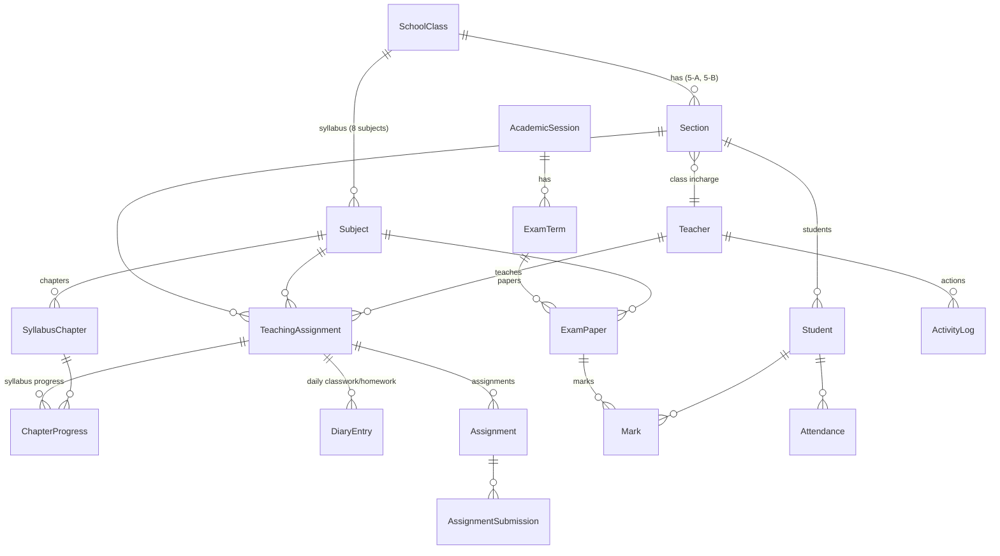

# Plan: From "Courses" to a School System (Class 1 to 10)

**Date:** 2026-11-04
**Status:** Approved, with the decisions below. Building in phases on branch `feature/school-system`.

---

## 1. How schools work, and what the LMS needs to match

Based on how school management systems are usually built (see Sources at the end):

| In a real school | What the LMS needs |
|---|---|
| The school runs **Class 1 to Class 10**, one **academic year (session)** at a time, e.g. 2026–27 | Classes 1–10 and sessions, instead of free-form "courses" |
| A class can have **sections** (5-A, 5-B) | Sections belong to a class |
| Each section has **one class incharge** (class teacher) | Section → class incharge teacher |
| Each class has a **fixed syllabus**: e.g. Class 5 learns 8 subjects, and each subject has chapters | Subjects are defined **per class**, with a chapter list |
| Each subject in each section is taught by a **subject teacher** (Maths in 5-A by Ms Sara, Maths in 5-B by Mr Omar) | A "teaching assignment": section + subject + teacher |
| The subject teacher **decides how to teach**: marks chapters as started or done, gives homework and assignments, takes tests | Syllabus progress, daily diary/homework, assignments, tests per section-subject |
| Exams are held in **terms** (First Term, Mid Term, Final). Each subject has a **paper**, and marks go on a **report card** with percentage, grade and position | Exam terms, papers, marks, report cards |
| At the end of the year, students are **promoted** to the next class | Promotion tool |
| The **principal/admin oversees** everyone: who taught what, who is behind on syllabus, who hasn't entered marks | Activity log + teacher activity page + oversight dashboards |

---

## 2. What changes in the current system

| Today | Becomes |
|---|---|
| `Course` (free-form, has one teacher) | **`SchoolClass`**: Class 1 … Class 10 (fixed list) |
| `Enrollment` (student ↔ course) | Removed: a student belongs to a **section**, and the section belongs to a class |
| `Section` (has one `teacher_id`) | `Section` belongs to a class and has a **class incharge** |
| `Subject` (belongs to a course, has **one** teacher) | `Subject` belongs to a **class** (that class's syllabus). Who teaches it is decided **per section** |
| — | **`TeachingAssignment`**: section + subject + teacher |
| — | **`SyllabusChapter`** and **`ChapterProgress`** (per section) |
| `Assignment` (subject + teacher) | Same, but linked to the **section** too (5-A and 5-B get different homework) |
| `Result` (free exam_type) | **`ExamTerm`** → **`ExamPaper`** (per class-subject) → **`Mark`** (per student) → report card |
| `Attendance` (per student per subject) | Kept per subject, or changed to **once a day by the class incharge** (your choice, see Q2) |
| — | **`ActivityLog`** (who did what and when) |
| — | **`AcademicSession`** (2026–27, 2027–28 …) |

### New data model

---

## 3. Who can do what

| Action | Admin (principal) | Class incharge | Subject teacher | Student |
|---|---|---|---|---|
| Set up session, classes, sections, subjects and chapters | ✅ | | | |
| Choose the class incharge and subject teachers | ✅ | | | |
| Admit students and move them between sections | ✅ | | | |
| Mark daily attendance | view all | ✅ own section | (✅ own periods, if per-subject) | own only |
| Mark syllabus chapters started/done; plan dates | view all | | ✅ own subject+section | view own |
| Daily diary (classwork and homework) | view all | view own section | ✅ own subject+section | view own section |
| Assignments: create, grade | view all | view own section | ✅ own subject+section | submit own |
| Exam papers: upload paper, enter marks | view all, lock/unlock | view own section | ✅ own subject+section | view own marks |
| Report card: remarks, finalize | ✅ approve | ✅ remarks, finalize | | view own |
| Promote students at year end | ✅ | suggest | | |
| Activity log and teacher activity | ✅ | | | |
| Announcements | ✅ school-wide | ✅ own section | ✅ own subject+section | view |

**One teacher can hold several roles.** Ms Sara can be the incharge of 5-A, teach Maths in 5-A and 5-B, and teach Science in 4-A. Permissions are worked out from her assignments, not from a fixed role.

---

## 4. Features, in phases

### Phase 1: School structure (the base everything else needs)
1. **Academic sessions** (2026–27), with one marked as current.
2. **Classes 1–10**, created automatically.
3. **Sections** per class (5-A, 5-B), each with a **class incharge**.
4. **Syllabus per class**: the admin defines the subjects for each class (Class 5: English, Urdu, Maths, Science, Social Studies, Islamiyat, Computer, Art), and the chapters of each subject.
5. **Teaching assignments**: the admin picks the teacher for each subject in each section. One screen per section shows all its subjects and teachers.
6. **Student admission**: roll number, admission number, guardian name and phone, date of birth. The student is placed in a section.
7. **Permissions rebuilt** on assignments (the `access.py` rules): a teacher reaches the sections they lead and the section-subjects they teach.
8. **Migration** of today's data (see Q1).

### Phase 2: Teaching (the subject teacher's control)
1. **Syllabus progress**: per section and subject, the teacher marks each chapter *not started / in progress / done*, with planned and actual dates. The school sees a coverage percentage, and the admin sees who is behind.
2. **Daily diary**: per period/subject, the classwork done and the homework given. Students see their section's diary. (Many Pakistani schools use a paper diary today.)
3. **Assignments** per section-subject (the current feature, attached to the new structure), with file uploads and grading as today.
4. **Class tests** per subject (quick marks entry, not part of the term report card unless chosen).
5. **Timetable** per section: periods per day, subject and teacher. Warns when a teacher is booked in two sections at the same time. Teachers see their own weekly timetable.

### Phase 3: Exams and report cards
1. **Exam terms** per session: First Term, Mid Term, Final (the admin sets the dates).
2. **Exam papers**: per class-subject-term, with total marks and date. The subject teacher can upload the question paper (PDF) for the admin to review before the exam.
3. **Marks entry**: the subject teacher enters marks for their section. The admin can **lock** marks after a deadline.
4. **Report card** per student per term: all subjects, marks, percentage, grade, **position in section**, attendance %, class incharge remarks. Printable / PDF.
5. **Result analysis**: per class, per subject, per teacher (average, pass %, top students).
6. **Promotion** at the end of the session: move passing students to the next class in one step, and keep the others.

### Phase 4: Admin oversight
1. **Activity log**: every create, update, delete, login and logout is recorded with who, what, when and from where. The admin can **filter by teacher name**, action, class or date.
2. **Teacher activity page** (open a teacher by name):
   - their classes, subjects, timetable;
   - last login;
   - syllabus progress per section;
   - assignments and diary entries this week;
   - marks still to be entered;
   - recent actions from the activity log.
3. **Oversight dashboard**: syllabus coverage per class, today's attendance per section (and sections that haven't marked it), marks entry status per paper, students with low attendance.
4. **Reports** exportable to Excel/PDF: attendance, results, syllabus coverage, teacher activity.

### Phase 5: Optional, often found in school systems (tell me which you want)
- **Parent portal**: parents log in to see their child's attendance, diary, results and report card, and announcements. One login for siblings.
- **Fee management**: monthly fee vouchers, payments, defaulters list, receipts. This is often the most-used module in Pakistani schools.
- **Teacher attendance and leave requests.**
- **SMS/WhatsApp/email alerts**: absence, results, fee due.
- **Student profile and documents** (B-Form, photo, previous school), and **transfer/leaving certificates**.
- **Library** and **transport**: less common for a first version.

### Chatbot
Its tools will need updating for the new structure. As you said, that comes later, together with the chatbot redesign.

---

## 5. Migrating today's data

Today's records don't map one-to-one onto the new structure. For example, a course isn't a class, and today a subject has a single teacher across all sections. Two options:

- **A. Start fresh** (simplest and cleanest): the new structure starts empty. The admin sets up classes, sections, subjects and teachers, and existing students, teachers and admin accounts are kept.
- **B. Migrate**: map each course to a class (you tell me which course is which class), keep the sections and attach them to classes, turn each subject's teacher into a teaching assignment for every section of that class, and keep assignments, submissions, attendance and results.

---

## 6. How it will be built

- Same approach as the fixes so far: **your code style**, a **migration** for each database change, **check scripts** for every rule (especially permissions), **browser testing** in Chromium, and **one commit per step** on a new branch.
- Order: Phase 1 → 2 → 3 → 4. Each phase is usable on its own, so you can stop or reorder after any phase.
- Rough size: Phase 1 is the largest change (it touches permissions everywhere). Phases 2–4 are mostly new pages on top of it.

---

## 7. Decisions (agreed 2026-11-04)

1. **Existing data**: start fresh (option A). Student, teacher and admin accounts are kept; the admin sets up the new structure.
2. **Attendance**: once a day per section, by the class incharge.
3. **Sections**: a class can have several sections (5-A, 5-B), each with its own incharge and subject teachers.
4. **Optional features**: all four:
   - parent portal;
   - fee management;
   - teacher attendance and leave;
   - student profile and certificates.

   They follow Phases 1–4 as Phase 5.

---

## Sources
- [Class On App: Syllabus Manager](https://classonapp.com/module/syllabus-manager)
- [Schoolites: syllabus completion tracking](https://schoolites.com/school-problems/syllabus-completion)
- [Class Matrix: syllabus tracker](https://classmatrix.org/feature/syllabus-tracker.php)
- [Edusys: K-12 syllabus management](https://www.edusys.co/en-in/school-syllabus-management.html)
- [Campus7: academic module](https://campus7.in/?p=12)
- [Academia ERP: most used school modules](https://academiaerp.com/blog/unlocking-the-potential-of-indian-education-top-school-management-system-modules-most-used-in-india)
- [eSchool.pk: Pakistan school management system](https://www.eschool.pk)
- [Schooli (Capterra)](https://www.capterra.co.za/software/1097145/Schooli)
- [Futuresol: ERP software for schools in Pakistan](https://www.futuresol.net/blog/best-erp-software-for-schools-in-pakistan)
- [Teach 'n Go: activity log / audit trail](https://intercom.help/teach-n-go/en/articles/16098614-activity-log-audit-trail)
- [Toddle: user activity logs](https://help.toddleapp.com/en/articles/12555246-how-can-i-view-user-activity-logs-across-my-school-on-toddle)
- [Google Classroom audit logs](https://workspaceupdates.googleblog.com/2021/09/google-classroom-activity-audit-logs-and-big-query-activity-logs.html)
- [CodeHS: administrator dashboard](https://help.codehs.com/en/articles/4253799-administrator-dashboard)
